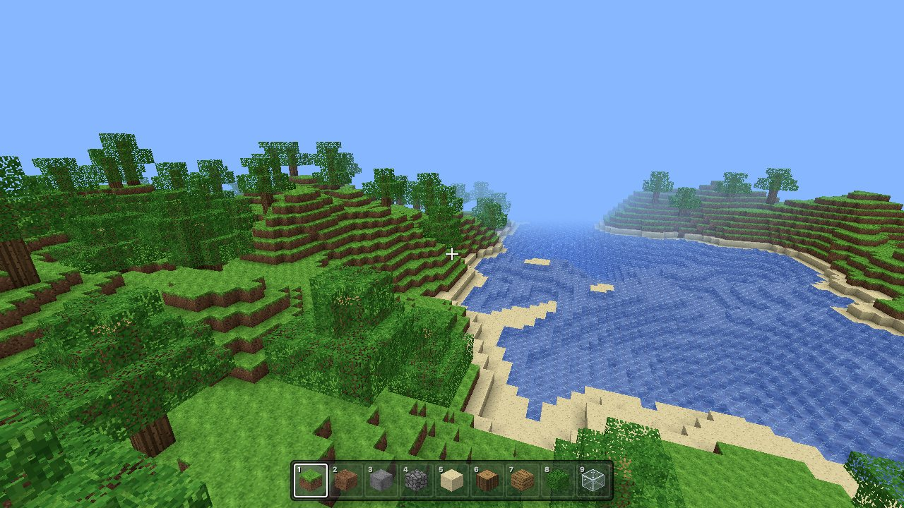
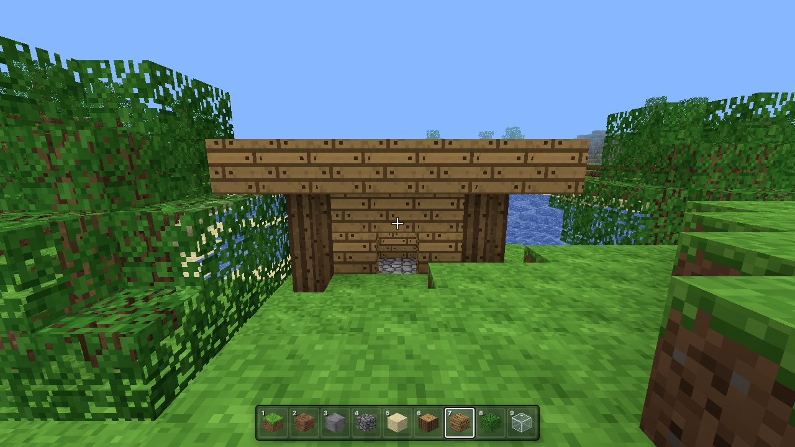
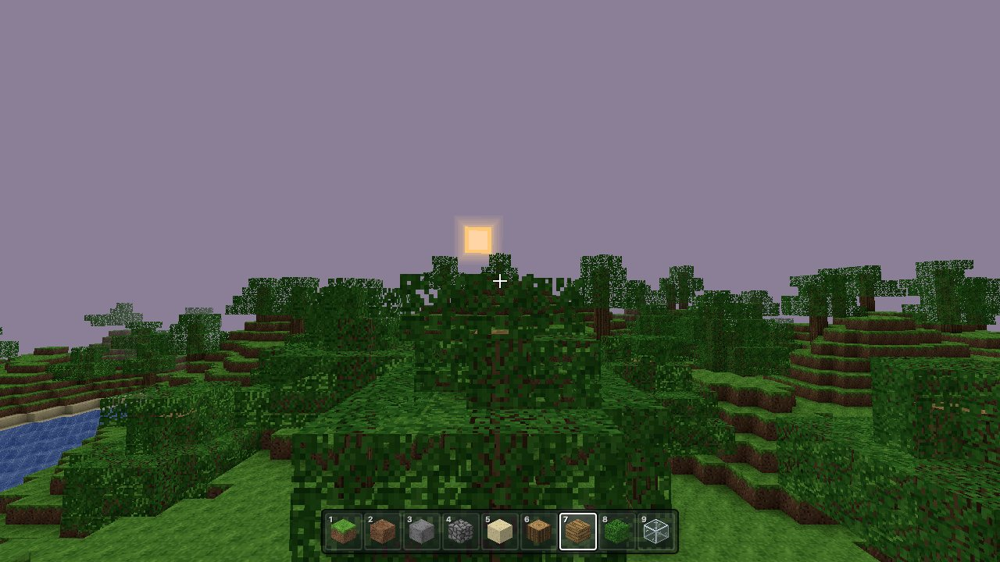
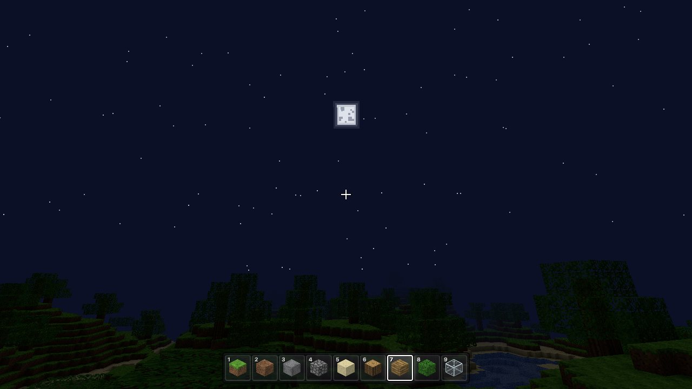
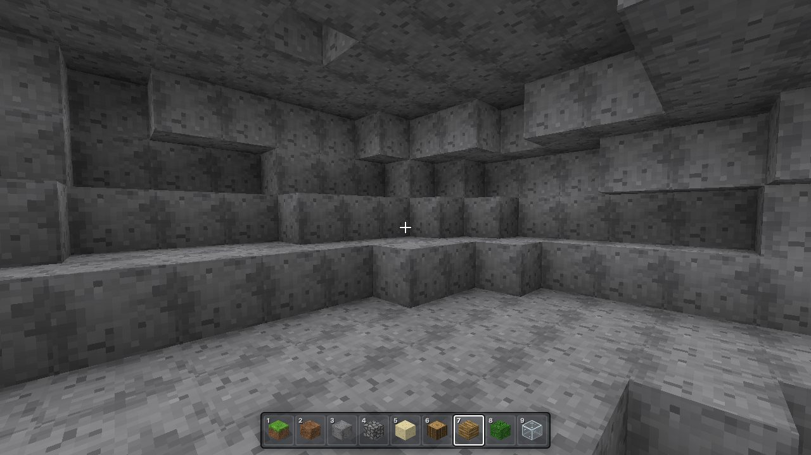
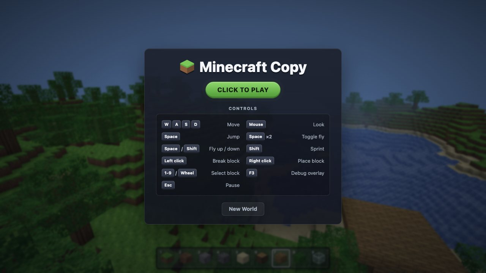

# Minecraft Copy

A first-person voxel sandbox that runs in your browser: endless procedurally generated terrain, block breaking and building, walking, swimming and flying, a full day/night cycle, and automatic saving. It's built from scratch with [three.js](https://threejs.org/) and [Vite](https://vite.dev/) in plain JavaScript, and every texture is generated in code at startup.

> **Unofficial fan project.** It isn't affiliated with, endorsed by, or connected to Mojang Studios or Microsoft. "Minecraft" is a trademark of Mojang Synergies AB. The project contains no Minecraft code, textures, sounds, fonts or logos; all art is generated procedurally.



| | |
| --- | --- |
|  |  |
|  |  |

## Features

- **Endless world.** Deterministic terrain from a seed: rolling hills, lakes and oceans, sand beaches, trees (including ones that cross chunk borders) and underground caves. Chunks generate and stream in around you as you move, and far ones are freed.
- **Build and break.** Nine placeable blocks (grass, dirt, stone, cobblestone, sand, log, planks, leaves, glass) with a target outline, instant breaking, and a hotbar with 3D block icons. Bedrock can't be broken, and you can't place a block inside yourself.
- **Movement.** Walking, sprinting and jumping with real collision, swimming (lower gravity, swim up, climb out at the shore), and a double-tap-Space fly mode.
- **Day and night.** A 10-minute cycle with sky colors running from blue through sunset to night, a sun, a moon with craters, stars, distance fog, and terrain that dims at night. Underwater gets its own blue-green fog.
- **Good looks for cheap.** Per-face shading plus baked ambient occlusion, pixel-art textures painted on a canvas at startup, and translucent water.
- **Saves itself.** It autosaves to `localStorage` every 10 seconds and when you close the tab. A save stores your position, view, hotbar slot, time of day and only the blocks you changed; terrain regenerates from the seed.
- **F3 debug overlay.** FPS, frame time, position, chunk, facing, time of day, loaded and queued chunks, triangles, draw calls and seed.

## Play it

Requires [Node.js](https://nodejs.org/) 22.12 or newer.

```sh
git clone https://github.com/brodypark/minecraft-copy.git
cd minecraft-copy
npm install
npm run dev
```

Open the URL Vite prints (usually http://localhost:5173) and click the game to start. It was developed and tested in Chrome; any modern desktop browser with WebGL and pointer lock should work.

To play a specific world, add a seed to the URL, e.g. `http://localhost:5173/?seed=1337`.



## Controls

| Input | Action |
| --- | --- |
| Click | Capture the mouse / resume |
| W A S D | Move |
| Mouse | Look around |
| Space | Jump (swim up in water) |
| Space twice quickly | Toggle fly mode |
| Space / Shift while flying | Fly up / down |
| Shift | Sprint |
| Left click | Break the targeted block |
| Right click | Place the selected block |
| 1–9 or mouse wheel | Choose a hotbar block |
| F3 | Toggle the debug overlay |
| Esc | Pause (release the mouse) |

The pause menu also has a **New World** button. It asks for confirmation, then starts a fresh random world.

## Scripts

```sh
npm run dev         # dev server with hot reload
npm run build       # production build into dist/
npm run preview     # serve the production build
npm test            # 284 unit tests (vitest): terrain, mesher, physics, raycast, save, UI helpers...
npm run test:smoke  # starts the dev server, plays for 5 s in headless Chrome, and fails on any
                    # console error or warning (skipped if Google Chrome isn't installed)
```

## How it works

- **Chunks:** the world is 16×16×64 block chunks stored as `Uint8Array`s. Chunks generate within 7 chunks of the player, mesh and draw within 6, and unload beyond 9. Each frame generates and meshes at most 2 chunks, nearest first; edited chunks remesh the same frame.
- **Terrain** (`src/world/terrain.js`): seeded simplex noise (`simplex-noise` + `alea`) builds fractal height, then layers of bedrock, stone, dirt, grass or sand, water up to sea level, hashed tree placement and 3D-noise caves. The same seed always produces the same world, in any chunk order.
- **Mesher** (`src/render/mesher.js`): a pure function from chunk data to typed arrays. It culls hidden faces, bakes per-face shading and ambient occlusion into vertex colors, flips the quad diagonal to avoid AO artifacts, and splits output into opaque and water geometry. It takes about 0.4 ms per chunk, so no Web Worker is needed.
- **Physics** (`src/player/physics.js`): axis-by-axis AABB collision against the voxel grid with substepping, gravity, jumping, flying and swimming. It has no three.js dependency and is fully unit-tested.
- **Interaction:** an Amanatides & Woo voxel raycast (reach 5) finds the targeted block and face.
- **Rendering:** a single 256×256 canvas texture atlas with nearest filtering, `MeshBasicMaterial` with vertex colors, and fog. Brightness for day/night is a material color multiplier, so nothing is re-lit per vertex.

## Project structure

```
src/
  main.js        boot, game loop and wiring
  config.js      every tunable constant (world size, physics, terrain, sky, AO, caves...)
  blocks.js      block ids and registry
  render/        texture atlas, mesher, chunk meshes, renderer, sky, target outline
  world/         chunk storage, terrain generator, world/streaming, raycast
  player/        physics, input/pointer lock, player + camera, break/place rules
  ui/            HUD + pause menu, hotbar, F3 overlay, styles
  save/          save format, validation and autosave
tests/           unit tests, plus tests/smoke/ for the browser smoke test
docs/            screenshots
```

## How it was built

An AI coding agent built this project as a "manager" coordinating parallel sub-agents, following the spec in [`PROJECT.md`](PROJECT.md). Each task was verified with tests, builds and headless-browser screenshots before being committed, and an independent reviewer agent audited the result at the end. The paper trail is in the repo:

- [`PROJECT.md`](PROJECT.md): the spec and task list.
- [`DECISIONS.md`](DECISIONS.md): every design decision, deviation and measurement.
- [`MANUAL_CHECKS.md`](MANUAL_CHECKS.md): what a human should verify by playing.
- `dashboard.html` / `status.json`: the live agent dashboard used during the build. Serve the folder with `python3 -m http.server 8000` and open `/dashboard.html`.

## Known limitations

- **No light propagation.** Caves are lit like the surface; only ambient occlusion and the global day/night brightness darken things.
- **Water is static.** It doesn't flow, and its surface is a full block.
- **Caves never reach the surface.** Dig to find them.
- **One save slot per browser,** stored in `localStorage`; private windows or clearing site data lose it.
- **Fixed render distance** of 6 chunks (`RENDER_DISTANCE` in `src/config.js`).
- **Desktop only.** It needs pointer lock with a mouse and keyboard; there are no touch controls.
